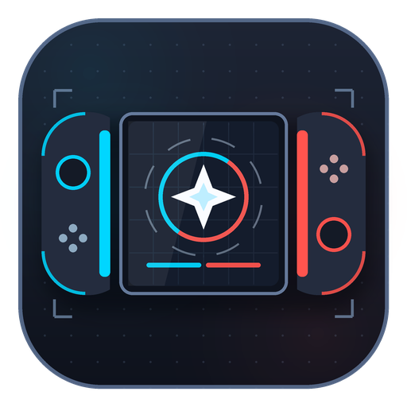
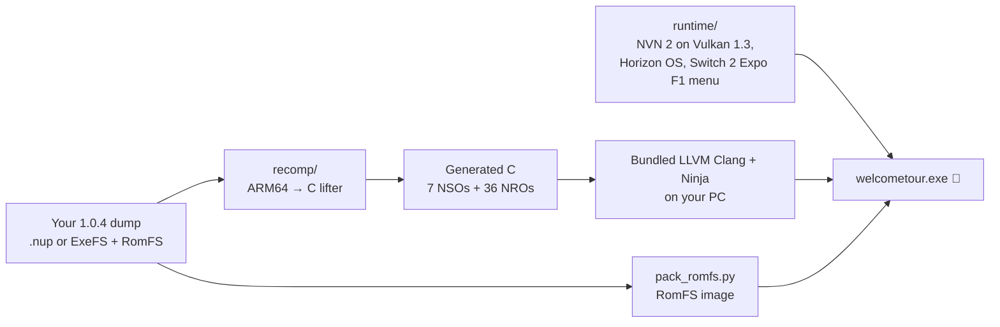

<div align="center">



# 🧭 SteelTemple Welcome Tour

### Nintendo Switch 2 Welcome Tour, running natively on Windows PC

*A static recompilation of the Nintendo Switch 2 game, not an emulator.*

[](#-requirements)
[](#-under-the-hood)
[](#-quick-start)
[](https://github.com/STS78721/BYEGUIDE/releases/tag/0.1.0)
[](#-credits--licence)

**[Quick start](#-quick-start)** · **[Features](#-highlights)** · **[Status](#-status)** · **[How it works](#-under-the-hood)** · **[Changelog](CHANGELOG.md)** · **[Credits](#-credits--licence)**

</div>

---

> [!WARNING]
> **Early Release (`0.1.0`):** *Nintendo Switch 2 Welcome Tour* is booting, rendering, and running at a locked **60 FPS** across **1080p**, **1440p**, and **4K**, but this is an **early `0.1.0` release** — you may still encounter rendering quirks, minigame edge cases, or performance differences across different GPU/CPU configurations. Updates will continue to polish exhibits, minigames, stability, and performance.

> [!IMPORTANT]
> **No game files are included.** You need your own legally dumped copy of **Nintendo Switch 2 Welcome Tour (`1.0.4`, Title ID `040057C02159A000`)** (either a `.nup` container or `ExeFS` and `RomFS` dump folders). This repository contains only the recompiler, runtime, launcher, and setup tools.

> [!NOTE]
> **Clean Zero-Config Defaults:** SteelTemple Welcome Tour launches on a safe, hardware-agnostic baseline (`1920x1080` windowed, Original internal resolution, Switch 2 Expo `F1` menu, `16x` anisotropic filtering, AMD FSR, Frame Generation Off, `60 FPS` limit, automatic language detection across all 14 supported languages) with no personal `.ini` settings bundled. Adjust resolution up to native `4K (2160p)`, language, upscaling, and controls anytime in **WelcomeTourLauncher** or in-game (`F1`).

## ✨ Highlights

<table>
<tr>
<td width="50%" valign="top">

### 🚀 Native Windows PC binary (43 ARM64 modules)
Every ARM64 instruction across all **7 base modules** (`main`, `subsdk0`–`subsdk4`, `sdk`) and all **36 dynamic exhibit & minigame `.nro` modules** (`245,670` functions total) is translated **ahead of time** into C and compiled natively on your PC into `welcometour.exe`. No CPU interpreter runs while you play.

### 🖼️ Locked 60 FPS at 1080p, 1440p & Native 4K
Switch cleanly between **Original**, **720p**, **900p**, **1080p**, **1440p**, and **native 4K (`2160p`)** internal resolutions with live resolution hooks, dirty-band UI/font atlas uploads, async Vulkan replay, AMD FSR 1.0, Bilinear scaling, and colour presets.

### 🎨 Vulkan 1.3 renderer & SM86 shader pipeline
Translates Switch 2 NVN 2 commands and Ampere (`SM86`) shaders to Vulkan 1.3 (`0` validation errors, `0` shader failures) with full cubemap array IBL views, cumulative occlusion queries, and private GPU render target allocation.

</td>
<td width="50%" valign="top">

### 🧭 Switch 2 Expo F1 menu & 14 verified languages
Press **F1** or **Esc** (or **Back + Y** on a controller) for a native settings overlay in the **Switch 2 Expo** theme (plus Light and Dark themes) with live telemetry, config saving to `welcometour.ini`, and verified locale safety across all **14 supported languages** (unsupported OS locales automatically fall back to `en-US`; `pt` normalizes to `pt-BR`).

### 🖥️ Setup Wizard & WelcomeTourLauncher (.nup & direct dumps)
Install cleanly with **`SteelTemple-WelcomeTour-0.1.0-Full-Setup-Wizard.exe`** or the portable archive: bundled LLVM-MinGW, Ninja, and Python verify all 9 `1.0.4` ExeFS SHA-256 hashes, extract all 36 dynamic `.nro` modules, and build `welcometour.exe` locally with no external tools required.

### 🕹️ Controllers, mods & local save backups
Supports Xbox, DualSense, Nintendo Switch / Switch 2 Pro controllers, and keyboard out of the box. Includes quick folder access, built-in GitHub release updates, and timestamped save snapshots inside **WelcomeTourLauncher**.

</td>
</tr>
</table>

## 📊 Status (`0.1.0` Early Release)

| Area | State |
|---|---|
| Boot, Expo title screen, menus & audio | ✅ Working |
| Exhibit halls & dynamic `.nro` minigame loading (36 NROs) | ✅ Working |
| Native internal resolution (`1080p`, `1440p`, `2160p` 4K at locked 60 FPS) | ✅ Working |
| Language & locale safety (`auto` + 14 verified languages) | ✅ Working |
| Hardware-specific console demos (mouse-mode / camera / sensor gimmicks) | ⚠️ Early release — some console-only hardware exhibits may require workarounds |
| Online features | ❌ Not supported, by design |

## 🚀 Quick start

**1. Install SteelTemple Welcome Tour**

Download **`0.1.0`** from the **[Releases page](https://github.com/STS78721/BYEGUIDE/releases/tag/0.1.0)**:
- Run **`SteelTemple-WelcomeTour-0.1.0-Full-Setup-Wizard.exe`** (no administrator rights required), or extract **`SteelTemple-WelcomeTour-0.1.0-Portable-StandAlone.zip`**.

**2. Set up from your Nintendo Switch 2 Welcome Tour `1.0.4` dump**

Open **WelcomeTourLauncher** → **SETUP FROM DUMP**, then choose one of:
- a **`.nup`** container (combined, or split base + `1.0.4` update in the same folder),
- a dump / NUP-extracted folder (flat `ExeFS` + `RomFS`, or `updates\<ver>\exefs`), or
- your **`ExeFS`** and **`RomFS`** folders directly.

Click **VERIFY & BUILD WELCOMETOUR.EXE**. Setup verifies all 9 `1.0.4` ExeFS SHA-256 hashes, packs RomFS, extracts all 36 dynamic `.nro` modules, lifts all 43 ARM64 modules to C, compiles `welcometour.exe` natively, and runs a short muted shader pre-warm pass.

**3. Play:** click **PLAY WELCOME TOUR PC** (or run `welcometour.exe`).

<details>
<summary>Building from source (developers)</summary>

```bat
python tools\check_content.py
python recomp\gen.py --exefs "<dump>\exefs" --out generated\welcometour104 --patches recomp\patches-welcometour104.txt --modules main,subsdk0,subsdk1,subsdk2,subsdk3,subsdk4,sdk --nros "<dump>\romfs\nro\Ounce_Release"
python tools\pack_romfs.py --dir "<dump>\romfs" --out romfs_packed
python tools\build_game.py --version welcometour104 --expected tools\data\expected-welcometour104.json --gen generated\welcometour104 --exefs "<dump>\exefs" --romfs romfs_packed
python tools\build_welcometour_release.py
```

</details>

## 🖥️ Requirements

| | Minimum | Recommended |
|---|---|---|
| OS | Windows 10 64-bit | Windows 11 |
| CPU | x86-64 with AVX2 | 8 cores or more |
| GPU | Vulkan 1.3, 6 GB VRAM | NVIDIA RTX 30/40/50 or AMD RX 6000/7000, 8+ GB VRAM |
| RAM | 16 GB | 32 GB |
| Disk | ~6 GB free during setup | NVMe SSD |

## ⚙️ Settings & Supported Languages

Press **F1** / **Esc** in game or configure before launch inside **WelcomeTourLauncher**. Settings save cleanly to `welcometour.ini` next to `welcometour.exe`, and any option can also be overridden with `WELCOMETOUR_` / `NS2_` environment variables.

- **Supported Game Languages (14):** `en-US`, `en-GB`, `ja`, `fr`, `fr-CA`, `de`, `it`, `es`, `es-419`, `nl`, `pt-BR`, `zh-Hans`, `zh-Hant`, `ko`.
- **Automatic Locale Safety:** Leaving Game Language on **`auto`** follows your Windows locale automatically, normalizes `pt` -> `pt-BR`, and safely maps unsupported OS locales (such as `ru-RU`, where the game ships only an empty stub archive) to `en-US`.

## 🔧 Under the hood



- **CPU:** *Nintendo Switch 2 Welcome Tour*'s 7 static ARM64 modules (`main`, `subsdk0`–`subsdk4`, `sdk`) and 36 dynamic `.nro` modules are statically lifted to C ([`recomp/`](recomp/)); [`runtime/`](runtime/) supplies the Horizon OS kernel, C++ exception unwinding across lifted modules, load-order symbol resolution, memory management, audio, input, and the Switch 2 Expo settings UI.
- **GPU:** Switch 2 NVN 2 commands translate onto **Vulkan 1.3** with Ampere (`SM86`) shader lowering (`RED.E`, `TLD.SCR.LZ.MS`, `TLD4.SCR.F16`), dirty-band font/UI atlas uploads, private GPU render target allocation, cubemap array IBL views, cumulative occlusion queries, async Vulkan replay, AMD FSR 1.0, and 60 FPS frame pacing.
- **Release Versioning:** [`VERSION`](VERSION) / [`launcher/welcometour_version.txt`](launcher/welcometour_version.txt) drive the version label across the Setup Wizard, `WelcomeTourLauncher`, Windows Installed Apps, and `welcometour.exe`, alongside [`CHANGELOG.md`](CHANGELOG.md).

## 🙏 Credits & licence

Built with **Universal NS2 to PC**, **Eglantine** (Ampere SM86 shader lowering), **Ryujinx**, **SDL3**, **Dear ImGui**, **Vulkan Memory Allocator (VMA)**, **libopus**, **libvpx**, **dav1d**, **zstd**, and **FidelityFX FSR**.

Licensed under the **GNU GPL v3 or later** (see [`LICENSE`](LICENSE)); permissive and third-party notices are preserved in [`THIRD_PARTY_NOTICES.md`](THIRD_PARTY_NOTICES.md).

---

<div align="center">

<sub>Nintendo Switch 2 Welcome Tour is a trademark of Nintendo. This is an unofficial non-commercial fan research project, not affiliated with or endorsed by Nintendo. Please support the official release.</sub>

</div>
